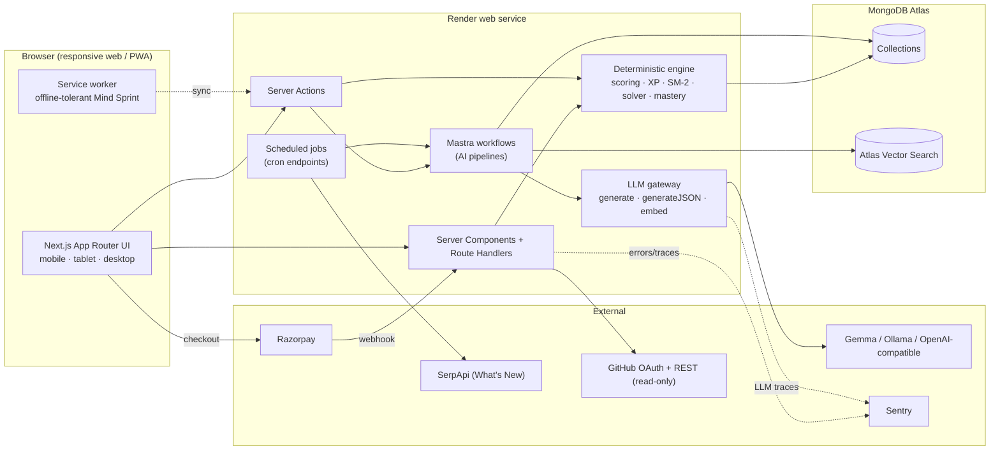
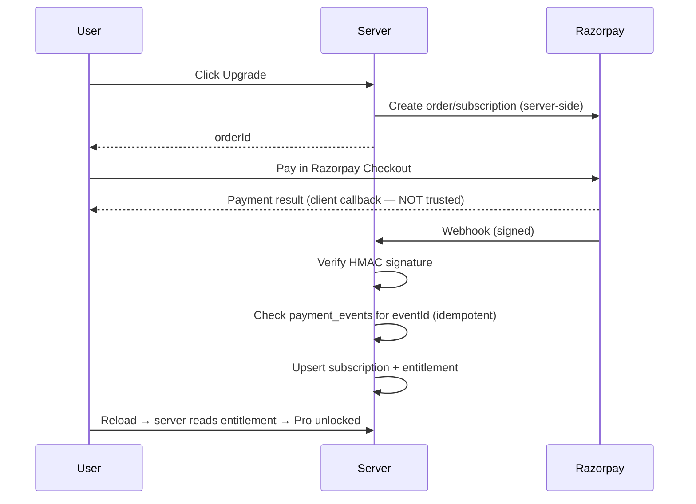

# architecture.md — System Architecture

> Read after: BLUEPRINT.md · Read before: MODULES.md
> Sponsor/tool free-tier terms change often. **Verify each before depending on it** (see §13).

---

## 1. System diagram



## 2. Stack and why

| Layer | Choice | Why |
|---|---|---|
| Framework | Next.js (App Router), TypeScript strict | One codebase for UI + API; SSR for fast first paint; responsive via Tailwind |
| Styling | Tailwind + CSS variables (tokens from UI_SPEC) | Mobile-first breakpoints; token-driven theming |
| Components | Own primitives (Card, Chip, Tabs…), optionally Radix primitives for a11y | Matches reference design; accessible behaviours for free |
| DB | MongoDB Atlas (M0 free tier) | Flexible lesson/question docs; **Atlas Vector Search** removes need for a separate vector DB |
| Validation | Zod at every boundary | Safe parsing of user input and LLM output |
| Auth | Auth.js (email, Google, GitHub) | Standard, httpOnly sessions |
| Payments | Razorpay (India) | No setup fee; Stripe test mode is fallback |
| AI orchestration | Mastra (TypeScript) | Typed workflows for extraction/generation/grading |
| Models | Gemma (primary), Qwen/Llama via Ollama or any OpenAI-compatible host | Open-weight; swappable behind gateway |
| Observability | Sentry (errors + LLM traces) | Sponsor + free tier |
| Hosting | Render | Sponsor; free web service sleeps when idle |
| Diagrams/animation | React + SVG + CSS | No video; every animation must teach |

> A free Render instance cannot run a 7B model. "Local inference" applies to developer/demo machines. Production-like environments call a hosted free API through the gateway.

## 3. Folder structure

```
/
├─ docs/                      # all .md specs (this folder)
├─ src/
│  ├─ app/                    # Next.js routes (App Router)
│  │  ├─ (marketing)/         # landing, pricing
│  │  ├─ (auth)/              # sign-in, sign-up
│  │  ├─ (app)/               # authenticated shell (responsive nav)
│  │  │  ├─ home/
│  │  │  ├─ progress/
│  │  │  ├─ bookmarks/
│  │  │  ├─ settings/
│  │  │  ├─ m1/               # DSA rounds
│  │  │  ├─ m2/               # quizzes
│  │  │  ├─ m3/               # tech bites
│  │  │  └─ m4/               # logic practice
│  │  └─ api/                 # route handlers (webhooks, cron, health)
│  ├─ components/
│  │  ├─ ui/                  # Card, Chip, SegmentedTabs, Stepper, BottomCTA…
│  │  ├─ shell/               # AppShell, SidebarNav, BottomNav, ContextPanel
│  │  └─ modules/{m1..m4}/
│  ├─ lib/
│  │  ├─ db/                  # client, models, repositories (user-scoped)
│  │  ├─ llm/                 # gateway + providers + prompts
│  │  ├─ engine/              # deterministic: scoring, xp, sm2, mastery, solver
│  │  ├─ ai/                  # Mastra workflows
│  │  ├─ payments/            # razorpay, entitlements
│  │  ├─ security/            # rate-limit, csp, sanitize, crypto
│  │  └─ telemetry/           # sentry helpers
│  ├─ content/                # JSON seeds: problems, bugs, lessons, puzzles
│  ├─ styles/tokens.css
│  └─ types/
├─ scripts/                   # seed, verify-puzzles, verify-bugs
├─ tests/                     # unit, integration, e2e
└─ public/
```

## 4. MongoDB collections

All user-owned documents carry `userId` and are accessed **only** through repositories that inject it.

| Collection | Key fields | Indexes |
|---|---|---|
| `users` | email, name, image, role, targetRole, stack[], plan, createdAt | `{email:1}` unique |
| `profiles` | userId, skills[{name,level,source}], resumeMeta, keepResume | `{userId:1}` unique |
| `progress` | userId, module, itemId, status, stage, updatedAt | `{userId:1, module:1, itemId:1}` unique |
| `attempts` | userId, module, itemId, answer, correct, ms, changes, confidence, ts | `{userId:1, ts:-1}`, `{userId:1, itemId:1}` |
| `mistakes` | userId, source, itemId, reason, retries, lastSeen | `{userId:1, itemId:1}` |
| `bookmarks` | userId, module, itemId, ts | `{userId:1, module:1, itemId:1}` unique |
| `srs_cards` | userId, itemId, ease, interval, due | `{userId:1, due:1}` |
| `xp_events` | userId, type, amount, refId, ts | `{userId:1, ts:-1}`, unique `{userId:1,type:1,refId:1}` (no double XP) |
| `milestones` | userId, key, unlockedAt, progress | `{userId:1, key:1}` unique |
| `streaks` | userId, current, longest, lastDay | `{userId:1}` unique |
| `questions` | id, skill, type, difficulty, payload, verified, source | `{skill:1, difficulty:1}` |
| `quiz_sessions` | userId, mode, questionIds[], startedAt, finishedAt | `{userId:1, startedAt:-1}` |
| `lessons` | id, title, outcome, paths[], prerequisites[], steps[], reference | `{id:1}` unique, `{paths:1}` |
| `puzzles` | id, category, params, solutionHash, verified | `{category:1, verified:1}` |
| `repos` | userId, owner, name, claims[], indexedAt | `{userId:1}` |
| `repo_chunks` | userId, repoId, path, lines, text, embedding | vector index `embedding`; `{userId:1, repoId:1}` |
| `subscriptions` | userId, provider, planId, status, currentPeriodEnd, providerRef | `{userId:1}`, `{providerRef:1}` unique |
| `payment_events` | eventId, type, processedAt | `{eventId:1}` unique (idempotency) |
| `news_items` | title, url, summary, fetchedAt | `{fetchedAt:-1}` TTL optional |

## 5. API / route list

Prefer **Server Actions** for first-party mutations; Route Handlers for webhooks, cron, and anything called externally.

| Route | Method | Purpose | Auth |
|---|---|---|---|
| `/api/auth/*` | – | Auth.js | – |
| `/api/payments/create-order` | POST | Create Razorpay order/subscription | user |
| `/api/payments/webhook` | POST | Verify signature, update entitlement | signature |
| `/api/me/export` | GET | Download all user data (JSON) | user |
| `/api/me` | DELETE | Delete account + data | user (re-auth) |
| `/api/m1/blitz/next` | GET | Next card(s) due | user |
| `/api/m1/audit/[id]` | GET/POST | Fetch snippet / submit answer | user |
| `/api/m1/open/[id]/grade` | POST | Grade free-text defence | user + Pro limits |
| `/api/m2/resume` | POST | Upload → extract → return skills for confirmation | user |
| `/api/m2/quiz` | POST | Create quiz session | user |
| `/api/m2/quiz/[id]/answer` | POST | Submit answer (deterministic scoring) | user |
| `/api/m2/repo/*` | – | Phase 2 scaffold | user |
| `/api/m3/lessons` | GET | Paths, search, lesson JSON | user/public |
| `/api/m3/lessons/[id]/progress` | POST | Save stage progress | user |
| `/api/m4/sprint` | GET/POST | Today's sprint / submit | user |
| `/api/m4/hint` | POST | Socratic hint (leak-checked) | user |
| `/api/cron/news` | POST | Refresh What's New | cron secret |
| `/api/cron/puzzles` | POST | Pre-generate + verify puzzles | cron secret |
| `/api/health` | GET | Health/keep-alive | public |

## 6. LLM gateway

```ts
interface LLMProvider {
  generate(req: { system: string; prompt: string; maxTokens?: number }): Promise<string>;
  generateJSON<T>(req: { system: string; prompt: string; schema: ZodType<T> }): Promise<T>;
  embed(texts: string[]): Promise<number[][]>;
}
```
- Providers: `ollama`, `google-ai` (Gemma), `openai-compatible`. Selected by `LLM_PROVIDER` env.
- `generateJSON`: parse → Zod validate → on failure **one** repair retry → else throw typed `LLMOutputError`.
- Every call wrapped in a Sentry span: model, latency, input/output tokens, success.
- Timeouts (default 8s) and a circuit breaker; callers must supply a **non-AI fallback**.
- Prompts live in `src/lib/llm/prompts/*.ts` as versioned constants.
- Untrusted text (resume, repo files) is always passed inside a delimited **data block** with an instruction that it is data only.

## 7. Deterministic vs AI split

| Task | Engine | Reason |
|---|---|---|
| MCQ scoring, XP, streaks, mastery, SRS | **Deterministic** | Must be exact and instant |
| Logic-grid correctness (exactly 1 solution) | **Deterministic solver** | LLMs are unreliable at this |
| Sequence / numerical answers | **Deterministic generators** | Computed answers |
| Bug validity (buggy ≠ original, fails tests) | **Deterministic sandbox** | Never serve unverified bugs |
| Confidence-vs-accuracy, heatmap | **Deterministic** | Aggregations |
| Skill extraction from resume | AI (+ user confirmation) | Language understanding |
| Question wording / variants | AI (+ validator) | Variety |
| Puzzle theme + clue wording | AI | Flavour only |
| Free-text defence grading | AI (rubric JSON) | Needs language judgement |
| Socratic hints | AI (+ leak check) | Adaptive guidance |
| Repo claim extraction + what-if scenarios | AI + vector search | Phase 2 |
| What's New summaries | AI | Summarisation |

## 8. Auth flow

1. Sign in via email magic link / Google / GitHub (Auth.js).
2. Session cookie: `httpOnly; Secure; SameSite=Lax`.
3. Middleware protects `(app)` routes; server code calls `requireUser()` which returns `userId`.
4. GitHub scope for Phase 2: `read:user` + public repo read only.

## 9. Payment flow (Razorpay)


- Entitlements are checked **server-side on every gated action**.
- Client checkout success only triggers a refetch; it never grants access.
- Test mode first; live keys only via env at deploy.

## 10. Security model

| Area | Control |
|---|---|
| Data isolation | Repository layer injects `userId`; no raw collection access in routes |
| Input | Zod on every route/action |
| Rate limiting | Per-IP and per-user on auth, LLM, upload, hint routes |
| Headers | CSP, HSTS, X-Content-Type-Options, frame-ancestors none, Referrer-Policy |
| Uploads | 5 MB max, MIME + magic-byte check, parsed in isolation, raw file deleted after extraction unless user opts in |
| PII | Resume text and repo chunks encrypted at rest (app-level, key from env) |
| Prompt injection | Untrusted content as data; strict JSON schemas; no tool/network access from extraction prompts |
| Secrets | Env vars only; never in client bundle (`NEXT_PUBLIC_` reviewed) |
| Webhooks | Signature verification + idempotency table |
| Privacy | Export + delete endpoints; no ads; no data sale |
| Sandbox | Bug-validation harness runs server-side with timeouts, no network, no FS write |

## 11. Responsive architecture

- **Mobile-first CSS.** Base styles = phone; `sm` 640, `lg` 1024, `xl` 1280 enhance.
- One route tree; **layout components** switch navigation (bottom nav → icon rail → sidebar). No separate mobile site.
- Data fetching is identical across devices; only presentation differs.
- Heavy visualisations (SVG) use `viewBox` scaling; desktop adds side-by-side panes.
- Service worker caches the app shell and Mind Sprint state; sync on reconnect.
- Full spec in `UI_SPEC.md` §4.

## 12. Deployment on Render

- Web service from the repo, build `npm run build`, start `npm run start`.
- Env vars set in Render dashboard (names listed in START_HERE.md).
- `/api/health` pinged every ~10 min by a free uptime monitor to reduce cold starts (free tier sleeps).
- Cron: use Render cron jobs (if available on plan) or an external scheduler hitting `/api/cron/*` with `CRON_SECRET`.
- Preview deploys for branches; production deploy from `main` only.

## 13. Sentry tracing plan

| Signal | Detail |
|---|---|
| Errors | Client + server, source maps uploaded, user id (hashed) only |
| Performance | Route transitions, server action duration |
| LLM spans | `llm.generate`, `llm.json`, `llm.embed`: model, latency, tokens, validation failures, repair retries |
| Alerts | LLM failure rate > 10%, webhook failure, p95 generation > 10s |
| PII | Never send resume text, repo content, or free-text answers to Sentry |

## 14. Sponsor usage matrix

| Sponsor | Decision | Role / fallback |
|---|---|---|
| MongoDB Atlas | **Use** | Primary DB + Vector Search |
| Render | **Use** | Hosting |
| Mastra | **Use** | Agent/workflow layer; fallback = plain async functions |
| Gemma | **Use** | Primary open-weight model; fallback Qwen/Llama via Ollama |
| Sentry | **Use** | Errors + LLM tracing |
| a.tech Domain | **Use if granted** | Custom domain |
| SerpApi | Maybe | What's New feed; fallback = curated RSS |
| ElevenLabs | Later | Mock interviewer voice (M2 Phase 3) |
| Temporal | Later | Durable ingestion only if jobs get complex |
| DigitalOcean, Tiger Data, Tinker, Backboard, Entire, TabPFN, Arduino, GitHub Copilot | **Skip for MVP** | Overlap or non-essential; Copilot may be used as a dev tool only |

*Confirm free terms on each sponsor's page before relying on them.*
